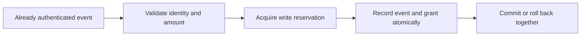

# Reliability patterns

An independent Python + SQLite specimen demonstrating how repeated event delivery can produce one persistent access grant per synthetic order.

**Scope:** educational specimen, authored separately with AI coding assistance and invented records. This is not extracted company code, a payment provider integration or a production-ready service.

## Run it

Python 3.12 or newer. No external dependencies, credentials or network access are needed.

```sh
python -m unittest -v
```

Run the command from this repository’s root. Tests create a temporary SQLite database and remove it afterward.

## The problem

An event may arrive again after a timeout. It may also arrive concurrently or with a new event identity for an order already handled. Deduplicating only in process memory loses protection when the process restarts.

This specimen stores event identities and access grants in SQLite. A transaction records the event and creates the grant together. Database uniqueness makes the desired invariant explicit: **at most one grant row for each order**.



## What the tests demonstrate

- Redelivery of the same event produces one stored event and one grant.
- Different event identities for one order still produce one grant.
- Reusing an event identity with different contents is rejected.
- Unknown orders and mismatched amounts leave no partial event record.
- A forced failure after event insertion rolls back the event and permits a later retry.
- Concurrent callers use separate SQLite connections; repeated and distinct deliveries do not double-grant.
- Reopening the store preserves deduplication.

## Decisions and tradeoffs

`BEGIN IMMEDIATE` acquires SQLite’s write reservation before the read/check/write sequence. This is deliberately simple and serializes writers. It is suitable for this bounded local specimen, not evidence of high-throughput distributed processing. Lock contention can exceed the connection timeout and raise an error; an application would need a bounded retry policy.

The event and grant live in the same database transaction. If the effect were an email, an external API call or a write to another database, this transaction would not make that effect atomic. An outbox and an idempotent consumer would be separate work.

The specimen assumes authentic, settled input. It does not implement signatures, replay-window policy, tenant authorization, refunds, payment reconciliation or retention. Its schema and rules are invented for the demonstration.

## Inspect the implementation

[Event store](event_store.py) · [Behavioral tests](test_event_store.py) · [Verification record](VERIFICATION.md) · [CI workflow](.github/workflows/tests.yml)

Tests are the executable usage example. For broader project context, see [my engineering portfolio](https://github.com/steffenkwik/engineering-portfolio).

Licensed under [MIT](LICENSE). That license covers only this independently authored specimen.
